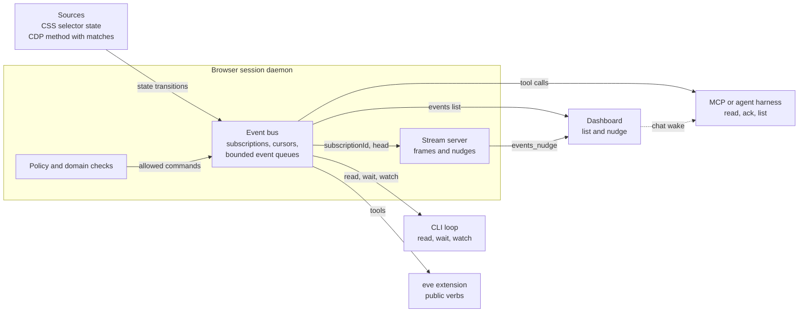
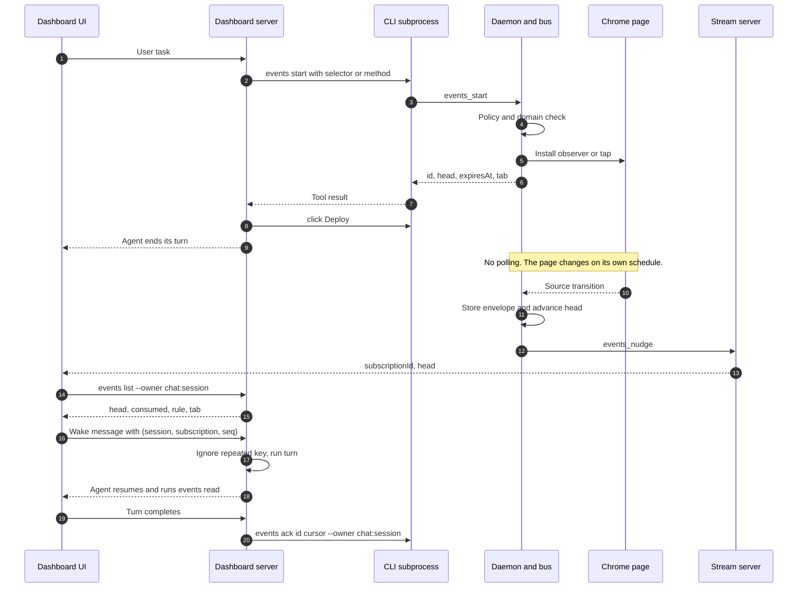

# Event bus architecture

How one session carries an event from a source in the page to a consumer such as the dashboard, and how the dashboard wakes an idle chat from it.

## One bus per session



The bus lives in `cli/src/native/events.rs`. It holds subscriptions and their events for the life of the session. A command that starts a subscription names a source; the bus owns the observer or tap and keeps storing until the subscription ends or is stopped.

## Sources

- A selector source watches one CSS selector in the current Chrome document and emits `element.visible` and `element.hidden`. `--state` chooses which transition is stored, and `--once` ends the subscription after the first stored event.
- A method source watches a CDP method and stores an event when the method fires. `--match` and `--match-regex` narrow it by a JSON pointer value.

Both sources run inside the existing CDP connection. The bus opens no network listener and does not create a second browser.

## Bus state

Each subscription has an id, owner, rule, status, reason, expiry, and tab. Its stored events are sequenced by a cursor:

- `head` is the newest stored sequence.
- `consumed` is the cursor the owner last acknowledged.
- Unread events are `head - consumed`.
- `dropped` counts events the bounded queue had to discard; the bus also stores an explicit `subscription.gap` marker with the missed count.

An event envelope is `{"version":"agent-browser.event.v1","meta":{...},"data":{...}}`. The `meta` object carries the event id, name, timestamp, cursor, subscription id, session and tab. Consumers read envelopes, never page internals.

## Operations

All verbs are ordinary agent-browser commands and honor policy, domain checks, output limits and `--json`.

| Verb | Purpose |
| --- | --- |
| `events start` | Create a subscription from a selector or method source. |
| `events read` | Read envelopes after a cursor, optionally waiting and acknowledging. |
| `events ack` | Advance the consumed cursor. |
| `events list` | List subscriptions with rule, status, reason, owner, head, consumed, dropped, tab and expiry. `--unread` filters to those with unread events. |
| `events stop` | End a subscription and remove its source. |

`events wait` is the CLI-only blocking form of `read --wait --ack`. `events watch` is a CLI-only NDJSON loop over `read`. MCP exposes the same operations through the shared parser.

## Consumers

Every consumer uses the same verbs. None of them is required for another to work, and the bus module contains no harness names.

- A plain CLI loop calls `events wait` or `events watch`.
- An MCP client calls the `events` tools.
- A harness with hooks, background tasks or a scheduler polls `events list --unread` or runs `events wait`, according to the recipe for that harness.
- The eve extension wraps the public verbs in its own tools.
- The dashboard hydrates from `events list` and listens for nudges.

## Nudge channel

The session stream WebSocket carries screencast frames and events on separate channels. The bus sends only a nudge:

```json
{"type":"events_nudge","subscriptionId":"ev_123","head":7}
```

The nudge carries no envelope and no page content. It is latest-value-wins per subscription id, so a burst of events cannot overwrite a newer head with an older one. The dashboard reacts by hydrating:

```text
agent-browser --session <session> events list --owner chat:<session> --json
```

It hydrates on connect, on every reconnect, on each nudge, and on a slow periodic backstop. A terminal event that arrives during screencast is therefore still seen even if nudges are coalesced.

## Wake rule

The dashboard owns `chat:<session>` subscriptions because the server stamps that owner on every `events` command the model sends. The dashboard wakes the chat only when all of these hold:

- The subscription is owned by `chat:<session>`.
- `head > consumed`.
- The chat is idle.
- The pair `(subscriptionId, head)` has not been delivered.
- The per-subscription rate limit has elapsed.

The wake message body includes `{"wake":{"subscriptionId":"<id>","seq":<head>,"cursor":"<id>:<head>"}}`. The text uses bus metadata only: subscription id, rule, unread count and tab id. It tells the agent to run `events read <id>` and never includes a page-supplied string.

The chat handler applies an idempotency key of `(session, subscriptionId, seq)`. A repeated key is ignored while its turn runs or after it completed. The handler runs `events ack <id> <cursor> --owner chat:<session>` only when that turn completes. The dashboard never acknowledges on its own.

## Sequence: subscribe, act, wake, read



A wake whose turn is cut off by a reload is not acknowledged. The event stays unread, and the next hydration and wake retry it. Delivery is at least once.

## Boundaries

- The bus never decides what matters. The client names the source and the rule.
- Event data is page content and untrusted. Wake text and nudge messages carry metadata only, and the dashboard strips any wake prefix from page-supplied strings before showing them.
- Every bus operation goes through the same policy and confirmation path as the rest of the daemon. Chat forces content boundaries on for `events` verbs.
- A selector subscription ends on navigation, tab close or expiry. It does not follow the agent across documents, tabs or frames.
- Chrome only.
